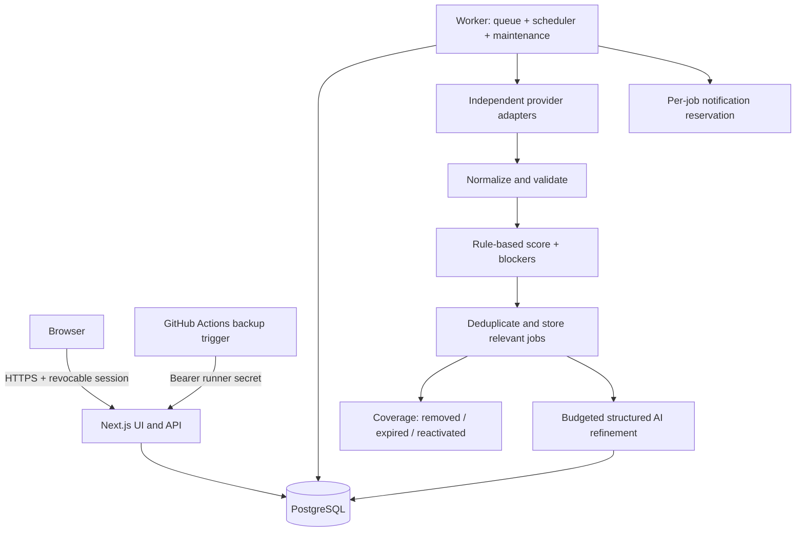

# Architecture

A personal, single-owner Next.js application and a separate Node.js worker share PostgreSQL. Railway runs both processes online. The browser never receives AI or provider credentials. Next.js route handlers authenticate every private request, validate input with Zod and call services using Prisma. There is no request-time scraper execution: searches are queued and executed by the worker.

## Boundaries

- `app`, `components`: accessible server/client rendering and route handlers. Route files only export handlers; logic lives in services.
- `lib/schemas.ts`: validated candidate, search, job and provider-configuration contracts.
- `lib/services`: `search` (run orchestration), `jobs` (ingestion, de-duplication, match persistence), `lifecycle` (removed/expired detection), `matching` (context and re-scoring), `queue`, `scheduler`, `settings`, `notifications`, `import`, `document-export`, `providers`, `usage` (AI budget).
- `providers`: adapters and extraction strategies. No user, database or ranking logic. `board.ts` is the shared full-board crawler.
- `matching`: pure functions: `score.ts` (engine), `knowledge.ts` (vocabulary, geography), `queries.ts` (title expansion).
- `ai`: provider transport, structured schemas, untrusted-content isolation and grounding checks.
- `workers`: queue loop, scheduler tick, maintenance and task processing, independent of the web lifecycle.

## Search run

1. A run and its task are created in one transaction (manual button, daily schedule, or the GitHub trigger). A partial unique index allows only one queued or running run.
2. The worker claims the task (`FOR UPDATE SKIP LOCKED`, lease with ownership token). `processSearchRun` is idempotent: finished runs are skipped; a crashed run restarts cleanly.
3. For each enabled provider (isolated try/catch): fetch → normalize → **score every listing** → keep those at or above the minimum score, best first, within per-source and per-run caps → ingest (URL/ID identity, canonical hash, guarded fingerprint and similarity de-duplication) → store the score and its evidence.
4. Providers that enumerate a complete listing report **coverage** (a scope per board or page). Vacancies missing from a fully fetched scope are marked removed; an empty listing for a board that had openings is treated as a glitch. Search-based sources verify older offers directly. Passed `validThrough` dates expire jobs.
5. If AI is configured, the best candidates are analysed in score order until the daily budget is reached; the result refines the ranking score but is capped by hard blockers.
6. The run finishes `FINISHED` (at least one source succeeded) or `FAILED` with diagnostics; a digest task is queued after success.

## Reliability

Task leases have ownership tokens: a stale worker cannot complete or retry a task claimed by a replacement. Heartbeats renew leases; retries back off exponentially to a final failure. The worker loop survives database outages. Provider exceptions are recorded per provider and never stop the run. Unexpected errors are retried by the queue before the run is declared failed. Queue SQL compares timestamps explicitly in UTC. Maintenance deletes expired sessions and old finished tasks and fails runs whose task is no longer active. The scheduler is idempotent (`scheduled:<local date>` key) so any number of workers or restarts create one run per day.

## Data

`CandidateProfile` (versioned) and `SearchProfile` are separate. A canonical `Job` owns many `JobPostingSource` rows (provider, source id, URL, scope, `removedAt`). Application tracking belongs to the canonical job and survives a source disappearing. `Job.rankScore` is what the interface sorts and notifies on; see [MATCHING.md](MATCHING.md). `JobNotification` (unique per job and channel) guarantees a job is announced once. `Resume` keeps the original bytes. `GeneratedDocument` is versioned. Owner-editable settings are `SystemSetting` rows validated against environment ceilings.

## Security and cost

Owner setup requires a deployment secret and is serialised with an advisory lock. Passwords use scrypt; sessions are random tokens stored only as hashes. Same-origin mutation checks, HTTP-only (secure in production) cookies and in-process rate limits protect the API; a test asserts every route authenticates. Outbound fetches to user-supplied hosts validate protocol, DNS and every redirect, cap bytes and time, and honour robots.txt. Scraped markup is converted to inert text. Uploads are checked by size, type and signature and parsed in a bounded worker thread.

AI usage reservations occur under a database lock before each request (including retries and document generation), using the exact configured token prices; unknown prices disable paid calls. The owner can lower limits in Settings but never exceed the environment ceilings.

## Deployment

A multi-stage Docker build produces non-root `web` and `worker` images from the same source. Railway runs both plus PostgreSQL; both run committed Prisma migrations on start. See [DEPLOYMENT.md](DEPLOYMENT.md).
